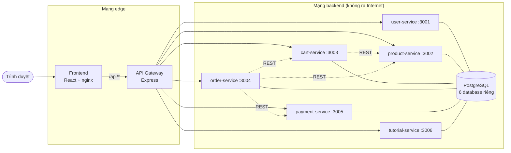
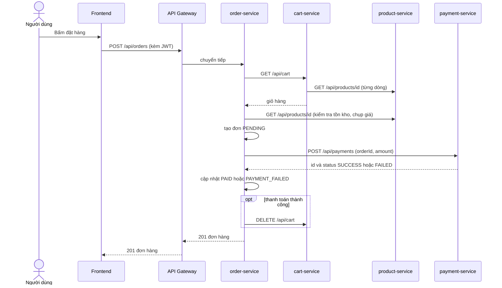
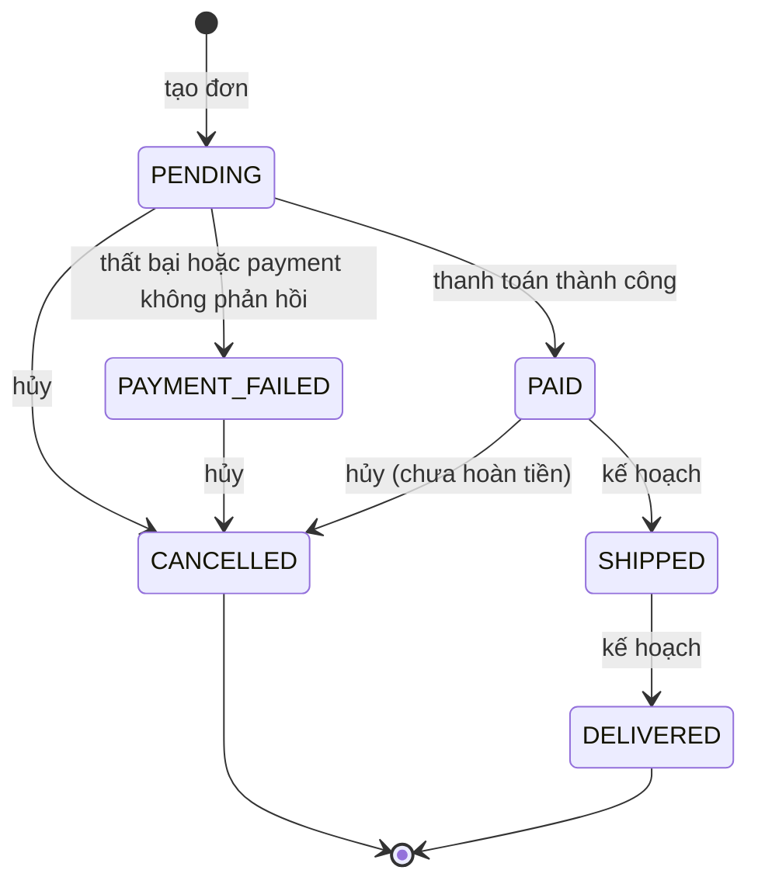
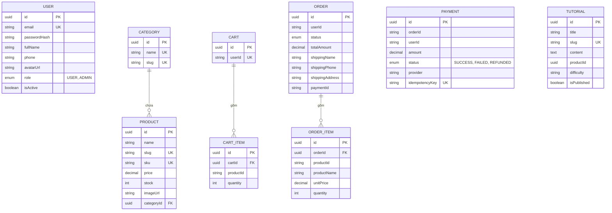
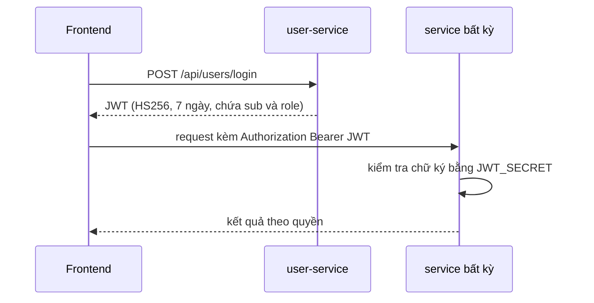
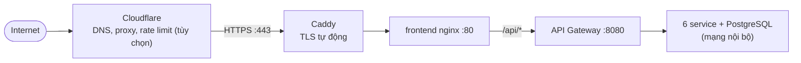

# Kiến trúc hệ thống — mQTT

mQTT là sàn thương mại điện tử bán thiết bị IoT kèm bài hướng dẫn kỹ thuật, xây dựng theo kiến trúc **microservices**. Tài liệu này mô tả kiến trúc **đang có trong repo**; những gì mới ở mức kế hoạch được đánh dấu rõ là *(kế hoạch)*. Chi tiết từng API nằm trong [`api-design.md`](api-design.md).

## 1. Mục tiêu thiết kế

- **Tách theo nghiệp vụ:** mỗi service sở hữu một phần nghiệp vụ và dữ liệu riêng, có thể phát triển, kiểm thử và triển khai độc lập.
- **Một cửa vào duy nhất:** trình duyệt chỉ nói chuyện với frontend và API Gateway, không bao giờ gọi trực tiếp service hay database.
- **Chạy lại được ở mọi nơi:** toàn bộ hệ thống khởi động bằng một lệnh `docker compose up`.
- **Thanh toán mô phỏng:** payment-service là bản demo, thiết kế sao cho thay bằng cổng thanh toán thật mà không phải sửa các service khác.

## 2. Kiến trúc tổng thể

Đường liền là request từ người dùng đi qua gateway. Đường chấm là lời gọi REST giữa các service với nhau.

### 2.1 Các thành phần

| Thành phần | Trách nhiệm | Công nghệ | Dữ liệu |
|---|---|---|---|
| **frontend** | Giao diện: duyệt sản phẩm, giỏ hàng, thanh toán, đơn hàng, trang admin | React + Vite, phục vụ bởi nginx; nginx chuyển tiếp `/api/` sang gateway | — |
| **api-gateway** | Cổng vào duy nhất: định tuyến theo tiền tố, giới hạn tần suất, CORS, header bảo mật, gom health check | Node.js 20, Express, `http-proxy-middleware`, `helmet`, `express-rate-limit` | — |
| **user-service** | Đăng ký, đăng nhập, cấp JWT, hồ sơ | Node.js 22, Express 5, Prisma, bcryptjs, jsonwebtoken | `user_db` |
| **product-service** | Sản phẩm và danh mục: CRUD, lọc, tìm kiếm | Node.js 22, Express 4, Prisma, zod | `product_db` |
| **cart-service** | Giỏ hàng của từng người dùng | Node.js 22, Express 4, Prisma, zod | `cart_db` |
| **order-service** | Điều phối đặt hàng, lưu đơn, hủy đơn | Node.js 22, Express 4, Prisma, zod | `order_db` |
| **payment-service** | Thanh toán mô phỏng, hoàn tiền, chống tính tiền hai lần | Node.js 22, Express 5, Prisma | `payment_db` |
| **tutorial-service** | Bài hướng dẫn kỹ thuật, gắn với sản phẩm | Node.js 22, Express 4, Prisma, zod | `tutorial_db` |
| **PostgreSQL 16** | Lưu trữ | `postgres:16-alpine` | 6 database, mỗi service một role |

Mỗi service có cùng bộ khung: `src/` (app, routes, controllers, services), `prisma/` (schema, migrations), `test/`, `Dockerfile`, `.env.example`. Logic nghiệp vụ nhận phụ thuộc qua tham số (dependency injection) nên kiểm thử được mà không cần database hay service khác.

## 3. Luồng đặt hàng (checkout)

Đây là luồng đi qua nhiều service nhất.

Điểm đáng chú ý:

- order-service **chuyển tiếp JWT của người dùng** sang cart, product và payment để các service đó tự xác thực.
- Giá được **chụp lại** vào `OrderItem` lúc đặt, nên đổi giá sản phẩm sau đó không làm đổi đơn cũ. Tổng tiền cộng theo đơn vị nhỏ nhất (×100) để tránh sai số số thực.
- Lỗi từ payment-service **không làm mất đơn**: đơn được lưu với trạng thái `PAYMENT_FAILED`, người dùng vẫn nhận phản hồi `201`.
- Xóa giỏ hàng chỉ thực hiện khi thanh toán thành công.

### 3.1 Vòng đời đơn hàng

Hủy đơn dùng cập nhật có điều kiện (`updateMany` kèm trạng thái hiện tại), nên hai lần hủy đồng thời không tạo ra trạng thái sai.

## 4. Dữ liệu

### 4.1 Nguyên tắc

- **Database per service:** mỗi service chỉ đọc ghi database của mình. Không có khóa ngoại và không có truy vấn chéo giữa các service. Service này tham chiếu service kia bằng **ID dạng chuỗi** (ví dụ `OrderItem.productId`) và hỏi lại qua API khi cần.
- Trong Docker Compose, cả 6 database nằm trên **một instance PostgreSQL** để tiết kiệm tài nguyên, nhưng được tách bằng quyền: script `infrastructure/docker/postgres/init-databases.sh` tạo mỗi service một **role riêng** (`user_svc`, `product_svc`, …), chỉ role đó mới kết nối được vào database tương ứng.
- Schema do **Prisma** quản lý. Khi khởi động, mỗi service chạy `prisma migrate deploy` để áp dụng các migration đã commit.

### 4.2 Mô hình dữ liệu từng service

Các trường `userId`, `productId`, `orderId`, `paymentId` nằm ở service khác nên **không phải khóa ngoại thật**. Đó là chủ ý của database-per-service. Hệ quả là việc đảm bảo nhất quán dữ liệu giữa các service do tầng ứng dụng đảm nhận (xem mục 7).

## 5. Xác thực và phân quyền

- **Cấp token:** chỉ user-service. Mật khẩu băm bằng bcrypt.
- **Kiểm tra token:** do **từng service** tự thực hiện bằng chung một `JWT_SECRET`. Gateway chỉ định tuyến, không kiểm tra token.
- **Phân quyền:** vai trò `USER` hoặc `ADMIN` nằm trong token. Thao tác ghi trên sản phẩm, danh mục, bài hướng dẫn và hoàn tiền yêu cầu `ADMIN`.
- **Dữ liệu riêng tư:** truy cập đơn hàng, thanh toán của người khác trả `404` thay vì `403`, để không lộ sự tồn tại của dữ liệu.
- **Frontend:** token lưu trong trình duyệt; trang admin được bảo vệ ở giao diện, nhưng quyền thật vẫn do backend kiểm tra.

## 6. Giao tiếp giữa các service

- **Đồng bộ qua REST/JSON** theo đường dẫn nội bộ (`http://product-service:3002/api/products/...`), dùng tên service trong mạng Docker.
- **Timeout:** các lời gọi service-to-service dừng sau `REQUEST_TIMEOUT_MS` (mặc định 5 giây); gateway dừng proxy sau 10 giây.
- **Chiều gọi:** `cart → product`, `order → cart, product, payment`. Không có vòng lặp. user và tutorial không gọi service nào.

### 6.1 Hành vi khi có sự cố

| Sự cố | Hành vi hiện tại |
|---|---|
| payment-service lỗi hoặc quá hạn | Đơn lưu với `PAYMENT_FAILED`, API vẫn trả `201` |
| Xóa giỏ hàng thất bại sau khi đã thanh toán | Chỉ ghi log; giỏ hàng còn nguyên nên người dùng có thể đặt trùng |
| product-service lỗi khi đọc giỏ hàng | cart-service trả `502` |
| Sản phẩm trong giỏ đã bị xóa | Giỏ bỏ qua dòng đó; checkout trả `400` |
| Service không phản hồi qua gateway | Gateway trả `503 SERVICE_UNAVAILABLE` |
| Hai yêu cầu thanh toán đồng thời cho một đơn | Khóa advisory của PostgreSQL xếp hàng, không tính tiền hai lần |
| Gửi lại yêu cầu thanh toán (mạng chập chờn) | `Idempotency-Key` trả đúng kết quả cũ |
| Database chưa sẵn sàng khi khởi động | Compose chờ healthcheck của Postgres; service tự khởi động lại nếu `migrate deploy` lỗi |

## 7. Triển khai

### 7.1 Docker Compose (đã có)

Toàn bộ hệ thống chạy bằng `docker compose up -d --build` từ `compose.yaml`.

- **Hai mạng:** `edge` (frontend ↔ gateway) và `backend` (gateway ↔ service ↔ Postgres). Frontend và trình duyệt không với tới backend.
- **Thứ tự khởi động:** Postgres healthy → 6 service healthy → gateway healthy → frontend. Mọi thành phần có `healthcheck` qua `/health`.
- **Cấu hình qua biến môi trường** trong `.env` (không commit): mật khẩu từng database, `JWT_SECRET`, `CORS_ORIGIN`, `TRUST_PROXY`. Biến thiếu làm compose dừng ngay với thông báo rõ.
- **Môi trường dev:** `compose.override.yaml` được Compose tự nạp, mở thêm các cổng `8081` (web), `8080` (gateway), `127.0.0.1:5432` (Postgres). Trên server không dùng file này.
- **Dữ liệu** của Postgres nằm trong volume `pgdata`.

| Cổng | Thành phần | Mở ra ngoài |
|---|---|---|
| 80 (trong container), 8081 (local) | Frontend nginx | Có |
| 8080 | API Gateway | Chỉ khi dev |
| 3001–3006 | 6 service | Không |
| 5432 | PostgreSQL | Chỉ `127.0.0.1` khi dev |

### 7.2 Mô hình production *(kế hoạch, chưa có trong repo)*

- **Một VPS** chạy Docker Compose; chỉ mở cổng 22 (SSH bằng key), 80, 443.
- **Caddy** làm cổng HTTPS (Let's Encrypt tự động). Số proxy đứng trước gateway là 2 (Caddy và nginx), hoặc 3 nếu có Cloudflare: đặt `TRUST_PROXY` tương ứng để giới hạn tần suất tính theo từng khách thay vì theo IP của proxy.
- `CORS_ORIGIN=https://<tên-miền>`, đổi mật khẩu tài khoản admin seed, backup định kỳ bằng `pg_dump`.
- Kubernetes không bắt buộc cho môn học; thư mục `infrastructure/kubernetes/` hiện để trống. Nếu cần có thể viết manifest dùng lại đúng các image này.

## 8. Bảo mật

| Biện pháp | Trạng thái |
|---|---|
| Chỉ một cổng vào, service và DB nằm trong mạng nội bộ | Đã có |
| Mỗi service một database và một role Postgres riêng | Đã có |
| Mật khẩu băm bcrypt, JWT HS256 có hạn | Đã có |
| Validate đầu vào bằng schema (zod, hoặc validator riêng ở payment); payment-service từ chối trường lạ | Đã có |
| Truy vấn qua Prisma (tham số hóa), tránh SQL injection | Đã có |
| `helmet` trên gateway và các service | Đã có |
| Giới hạn tần suất ở gateway, tính theo IP khách (`TRUST_PROXY`) | Đã có |
| Container chạy user `node`, không chạy root; image không chứa `.env` | Đã có |
| Payment: khóa idempotency, khóa advisory, giới hạn body 10 kB | Đã có |
| Giới hạn riêng cho `/login`, `/register` (chống dò mật khẩu) | Chưa |
| Header bảo mật cho trang web do nginx phục vụ (CSP, HSTS, …) | Chưa |
| Chỉ chấp nhận thuật toán HS256 ở mọi service (hiện chỉ user và payment ghim rõ) | Chưa |
| Kiểm tra `isActive` khi đăng nhập, chống dò email khi đăng ký | Chưa |
| JWT RS256 (chỉ user-service giữ khóa riêng) thay cho secret dùng chung | Chưa |
| Xác thực giữa các service bằng khóa nội bộ; chặn `POST /api/payments` công khai | Chưa |
| Chống DDoS tầng mạng (Cloudflare, firewall) | Kế hoạch |

## 9. Kiểm thử và chất lượng

- Mỗi service có test riêng chạy bằng `node --test` (gateway, order, payment, product, tutorial); test dùng DB giả nên không cần Postgres.
- Hiện chưa có test cho cart-service và chưa có pipeline CI. Nên thêm GitHub Actions: cài, `prisma generate`, chạy test, build image cho từng service riêng.
- Kiểm tra tích hợp bằng tay: đăng ký → xem sản phẩm → thêm giỏ → đặt hàng → xem đơn → hủy đơn; dùng `PAYMENT_DEMO_MAX_AMOUNT` để thử luồng thanh toán thất bại.

## 10. Quyết định kiến trúc

| Quyết định | Lý do | Đánh đổi |
|---|---|---|
| Giao tiếp đồng bộ bằng REST | Đơn giản, dễ gỡ lỗi, phù hợp quy mô đồ án | Checkout phụ thuộc nhiều service cùng lúc; chưa chịu lỗi tốt bằng hướng sự kiện |
| API Gateway chỉ định tuyến, không kiểm tra token | Giữ gateway đơn giản; mỗi service tự bảo vệ mình | Token bị kiểm tra nhiều lần; chưa có điểm kiểm soát xác thực tập trung |
| Database per service trên một instance Postgres | Cô lập dữ liệu bằng quyền nhưng tiết kiệm RAM | Chung tài nguyên máy chủ DB; muốn cô lập thật phải tách instance |
| Thanh toán qua giao diện provider | Thay ngân hàng giả bằng cổng thật chỉ cần viết thêm một provider (`charge`, `refund`) | Cổng thật cần thêm trạng thái chờ và webhook |
| Chụp giá vào đơn hàng | Đơn cũ không đổi khi giá sản phẩm thay đổi | Dữ liệu sản phẩm bị lặp một phần trong order-service |
| Nginx phục vụ frontend và chuyển tiếp `/api` | Một origin duy nhất, không cần cấu hình CORS phức tạp | Thêm một lớp proxy cần cấu hình `TRUST_PROXY` đúng |

## 11. Hạn chế và hướng phát triển

1. **Nhất quán dữ liệu giữa service:** trừ tồn kho khi đặt hàng, hoàn tiền khi hủy đơn đã thanh toán, xử lý trường hợp thanh toán xong mà lưu trạng thái lỗi. Hướng giải: saga điều phối trong order-service, hoặc sự kiện qua RabbitMQ (tùy chọn trong README) cùng mẫu outbox.
2. **Chịu lỗi:** thêm retry có backoff cho thao tác idempotent và circuit breaker cho các lời gọi giữa service.
3. **Quan sát:** `X-Request-Id` xuyên suốt từ gateway, log dạng JSON, endpoint `/metrics`.
4. **Tài liệu API:** OpenAPI cho từng service và đánh phiên bản `/api/v1`.
5. **Thống nhất định dạng lỗi** và kiểu dữ liệu tiền giữa các service (xem `api-design.md`, mục 10).
6. **Thống nhất nền tảng mã nguồn:** hiện có hai kiểu (CommonJS + Express 4 + zod, và ES Module + Express 5); nên chọn một để dễ bảo trì.
7. **Danh mục sản phẩm:** frontend còn dùng danh sách cố định trong khi dữ liệu thật nằm ở product-service; nên lấy từ `/api/categories`.